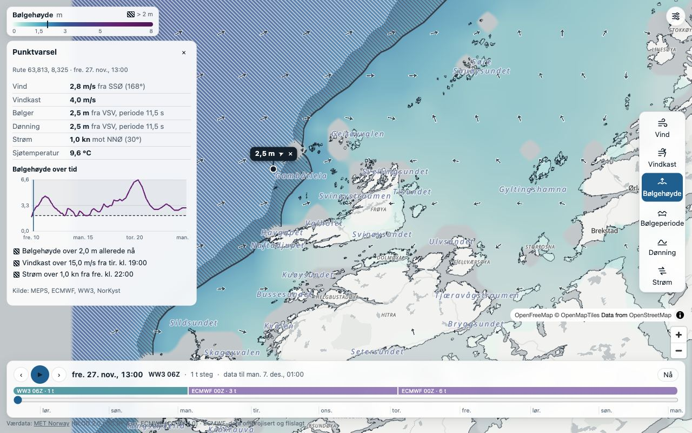

# weather-layers

Windy-style weather surfaces for a MapLibre vessel map: **wind, gusts, significant wave height,
wave period, swell and surface current** as colour fields with direction arrows, animated
particles, a ten-day timeline, click-for-values with a time-series chart and first threshold
exceedance, and threshold marking. Built from open MET Norway and ECMWF forecasts.
No keys, no accounts, no Docker, no database.

Two parts that meet through **files on disk**:

1. **`pipeline/`** (Python): fetches open forecast subsets (MEPS 2.5 km, WAVEWATCH III 4 km,
   NorKyst v3 800 m, ECMWF 0.25°), rotates and regrids them to Web Mercator and writes
   value-encoded PNG tiles, merged point-series chunks and a versioned `manifest.json`.
2. **`web/layer/`** (TypeScript): a framework-agnostic MapLibre GL JS 6 layer (GPU colour field,
   arrows, particles) plus a thin React adapter for react-map-gl 8 and ready UI components.
   **`web/demo/`** is a Vite + React demo using it on OpenFreeMap light/dark basemaps.



## Quick start (macOS/Linux, from a clean clone)

Requirements: [uv](https://docs.astral.sh/uv/) and Node.js ≥ 20.11 with npm. Nothing else (no GDAL,
no Homebrew packages, no Docker).

```sh
make setup      # uv sync (Python deps incl. eccodes wheels) + npm install + Playwright Chromium
make pipeline   # build the development area (Frøya/Hitra) into data/out  (~1 min, ~235 MB download*)
make dev        # demo on http://localhost:5173
```

`make dev` (= `npm run dev`) runs the pipeline first if `data/out` is empty, then starts Vite.
The demo serves `data/out` at `/weather-data/` behind a demo bearer token and fetches it through
an injected `fetch` that adds the token — the same hook a host uses for its own auth.

\* Most of the dev download is ECMWF: open data cannot be cut to an area, so each step is a
global field (~170 MB per run). Raw downloads are cached in `data/cache` during development.

Useful URL parameters for the demo: `layer=wave_height|current|…`, `theme=dark`, `particles=0|1`,
`lang=en`, `time=2026-11-28T12:00Z`, `view=lat,lon,zoom`, `panel=lat,lon`, `ramp=calm|vivid|viridis`,
`tstyle=hatch|tint|contour`, `debug=1` (fps and bytes loaded).

## Commands

| command | what it does |
|---|---|
| `make pipeline-norway` / `make dev-norway` | build Norway + its sea (polygon, ~3 min, ~0.95 GB) into `data/norway/`; demo on http://localhost:5175 |
| `make pipeline-coast` / `make dev-coast` | the same for the plain coast rectangle (`data/coast/`, port 5174) |
| `uv run --project pipeline weather-layers status` | summary of the published manifest |
| `uv run --project pipeline weather-layers validate` | validate `manifest.json` against `schema/` |
| `make crosscheck` | compare published values with api.met.no → `docs/crosscheck.md` |
| `make test` | pytest + Vitest |
| `make lint` / `make typecheck` | ruff, ESLint, Prettier / strict TypeScript |
| `make screenshots` | Playwright visual check → `docs/screenshots/` (needs pipeline output) |
| `node scripts/perf.mjs <url> <label> "name\|query" …` | performance budget measurement |

Configuration is by environment variables (`WEATHER_LAYERS_*`, see
[docs/deployment.md](docs/deployment.md)). In production set `WEATHER_LAYERS_USER_AGENT` to an
identifying name with a contact, as MET Norway's terms require.

## What you get

- **Layers**: wind, gusts (MEPS → ECMWF), wave height, wave period (WW3 → ECMWF), swell (WW3, to
  +66 h), current (NorKyst v3, to +120 h). One colour field at a time; arrows and particles show
  direction (wind and waves *from*, currents *to*, arrows point where the flow goes).
- **Timeline** from now to ~10 days, stitched per layer: hourly MEPS/WW3/NorKyst, then ECMWF
  3-hourly and 6-hourly. The model, run (e.g. "MEPS 06Z", "ECMWF 00Z") and step length are always
  shown, and the end of each layer's data is marked.
- **Click for values**: wind/gust with direction, waves (height, period, direction), swell,
  current, sea temperature at the chosen time, a chart over the whole timeline and the first time
  each threshold is exceeded — one request (~7–11 KB).
- **Thresholds** (placeholders: waves 2.0 m, gusts 15 m/s, current 1.0 kn) marked on the map.
- **Map UI** (Windy-style): layer rail, slim legend, settings popover, timeline with model/run/valid
  time, a draggable pin showing the active value and direction, and a crisp coastline above the field.
- **Areas** of any shape: `dev`, `coast`, `norway` (polygon), `w,s,e,n` or a GeoJSON polygon.
- **Units** m/s, m, s, kn. **Languages** nb (default) and en, from message files.
- Host hooks: injectable `fetch` + base URL, `setTime`/`setActiveLayer`/`setVisible`/
  `setParticles`/`setThresholds`, state events with the available time range.

## Results

| | |
|---|---|
| Cross-check vs api.met.no (tiles at MET's grid point) | wind 0.05 m/s / 0.9°, gust 0.06 m/s, current 0.05 kn / 2.9°, sea temperature 0.04 °C (mean abs diff); waves 0.14 m / 10° (MET uses WAM 800 m here, we use WW3 4 km) — [docs/crosscheck.md](docs/crosscheck.md) |
| Performance (whole coast, 1440×900 @2x) | first view ≤ 398 KB, step change ≤ 177 KB, click 1 request, 60 fps with particles — [docs/performance.md](docs/performance.md) |
| Norway run (polygon) | 3 min, 942 MB downloaded, 156 MB public output (9.0k files), ≈ 1.8 GB/day; rectangle: 1.87 GB; no-op rerun ~4 s |

## Docs

- [Architecture](docs/architecture.md) · [Data sources](docs/data-sources.md) · [Contract (files, manifest, encodings)](docs/contract.md)
- [Host integration](docs/host-integration.md) · [Deployment](docs/deployment.md) · [Performance](docs/performance.md)
- [Decisions](docs/decisions/) · [Progress](docs/PROGRESS.md) · [Screenshots](docs/screenshots/)

## Licences and attribution

Data: **MET Norway** (NLOD 2.0 / CC BY 4.0, "Based on data from MET Norway") and
**ECMWF** (CC BY 4.0; data modified: regridded and tiled; ECMWF accepts no liability for errors or
omissions). Basemap: [OpenFreeMap](https://openfreemap.org) © OpenMapTiles © OpenStreetMap
contributors.

Dependencies: every direct dependency is MIT, BSD, ISC or Apache-2.0. Transitive exceptions
(not added by us, used unmodified): `certifi` (MPL-2.0, CA bundle used by httpx and pyproj),
`typing_extensions` (PSF-2.0), and dev-only build tooling pulled in by Vite (`lightningcss`
MPL-2.0, `caniuse-lite` CC BY 4.0 data). Nothing copyleft ships in the browser bundle.
